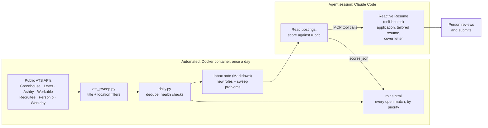

# job-discovery

A small job-discovery pipeline with two halves:

- **Automated, no LLM:** a Docker container reads companies' public applicant-tracking-system (ATS) job boards once a day. It filters the roles by title and location, keeps only roles it hasn't seen before, and writes a Markdown note plus an HTML page of every open match.
- **Agentic:** in a session started by a person, an LLM agent (Claude Code) reads that note, scores each role against a rubric, and tracks the chosen applications in a self-hosted [Reactive Resume](https://github.com/AmruthPillai/Reactive-Resume) through its MCP server. The agent prepares everything; a person reviews and submits every application.

This repo holds the code for the automated half. The agent half is a playbook, not code: [docs/agent-workflow.md](docs/agent-workflow.md) has the rubric, the steps and the MCP tool calls.

## Architecture



1. `scheduler.py` runs in the `job_discovery` container. Every 10 minutes it checks whether today's sweep has run, and runs it once the local time passes `RUN_HOUR`. A sweep missed while the host was asleep runs as soon as Docker is back.
2. `ats_sweep.py` reads every board in `data/companies.txt` (8 boards in parallel) and keeps roles whose title and location match the filters.
3. `daily.py` drops roles already in `data/seen.json` and writes `New roles YYYY-MM-DD.md` to the inbox folder. It also runs `viewer.py` to rebuild `data/roles.html`.
4. Every note carries a health check: boards that couldn't be read, boards that worked yesterday but failed today, boards that dropped to 0 roles, and a sweep with no matches at all. Each problem is also logged as `ERROR` in `docker logs job_discovery`, so a board that has moved to another ATS gets noticed instead of going quiet.
5. The agent session is started by hand. See [docs/agent-workflow.md](docs/agent-workflow.md).

## Supported job boards

Only public, unauthenticated endpoints that the board's robots.txt allows. No logins, and no scraping of sites that block bots.

| ATS | Line in `companies.txt` | Endpoint read |
|---|---|---|
| Greenhouse | `gh <board>` | `boards-api.greenhouse.io/v1/boards/<board>/jobs` |
| Lever | `lever <company>` | `api.lever.co/v0/postings/<company>` (falls back to `api.eu.lever.co`) |
| Ashby | `ashby <org>` | `api.ashbyhq.com/posting-api/job-board/<org>` |
| Workable | `workable <account>` | `apply.workable.com/api/v1/widget/accounts/<account>` |
| Recruitee | `recruitee <company>` | `<company>.recruitee.com/api/offers/` |
| Personio | `personio <company>` | `<company>.jobs.personio.de/xml` |
| Workday | `workday <host>/<tenant>/<site>` | `<host>.myworkdayjobs.com/wday/cxs/<tenant>/<site>/jobs` (paged, up to 2,000 roles) |
| SmartRecruiters | — | Reader written but **disabled**: `api.smartrecruiters.com/robots.txt` disallows crawlers |

Companies with no readable board can be listed as `# manual: Name | careers URL | reason`. Every note then reminds you to check them by hand.

## Setup

Needs Docker, or Python 3.10+ with no third-party packages.

```bash
cp .env.example .env                               # set VAULT_INBOX, HOST_DIR, TZ, RUN_HOUR
cp data/companies.example.txt data/companies.txt   # replace with your own target boards
docker compose config                              # check the resolved paths
docker compose up -d
docker logs -f job_discovery
```

| Setting (`.env`) | Meaning |
|---|---|
| `VAULT_INBOX` | Host folder the daily note is written to, e.g. an Obsidian vault's `00 Inbox`. Required. |
| `HOST_DIR` | Absolute host path of this repo, used for the roles-page link in the note. |
| `TZ`, `RUN_HOUR` | Container timezone, and the local hour after which the daily sweep runs. |

To run without Docker, point `JOB_VAULT` at a folder that contains `00 Inbox/`:

```bash
JOB_VAULT=/path/to/vault python3 -I daily.py --baseline   # first run: record everything open now as seen
JOB_VAULT=/path/to/vault python3 -I daily.py              # later runs: note the new roles
```

The filters are regular expressions at the top of `ats_sweep.py` (`TITLE`, `EXCLUDE`, `LOC`) and `daily.py`. As shipped they target ML/inference, C++/quant and backend engineering roles in Ireland, the UK and the EU, or remote. Edit them for your own search. `viewer.py` holds the keyword weights for the rough priority used before the agent has scored a role.

## Output

The daily note (trimmed), from a sweep of the example list:

```markdown
# New roles 2026-10-13

Read 8 of 8 company boards; 83 open roles match the filters; 33 are new since the last sweep.
All open matches, sorted by priority: [roles page](file:///…/job-discovery/data/roles.html).

| Company | Role | Location | Type | Posted |
|---|---|---|---|---|
| GitLab | [Backend Engineer, Create: Repository Management](…) | Remote, United Kingdom |  | 2026-09-29 |
| Reddit | [Staff Machine Learning Engineer, Ads Foundational Representations](…) | Remote - United Kingdom |  | 2026-10-07 |
| Spotify | [Backend Engineer - Platform Security](…) | London / hybrid |  | 2026-10-06 |

Not swept automatically, check by hand now and then: [Apple](https://jobs.apple.com/).
```

When something breaks, the note opens with a warning such as `> [!warning] Sweep problems` and `> - Readable yesterday, failed today: …`.

`data/roles.html` is one static page with no dependencies. It lists every open match, sorted by the agent's fit score (marked ★) where there is one, otherwise by the keyword priority. It has filters for contract, remote and recent postings, and a table showing which boards were read.

## Scripts

| Script | What it does |
|---|---|
| `daily.py [--baseline]` | Runs the sweep, dedupes it, writes the note and rebuilds the roles page. Run files go in `data/runs/`. |
| `scheduler.py` | The container's entry point: runs `daily.py` once a day after `RUN_HOUR`. |
| `ats_sweep.py companies.txt out.json [--all]` | Lists open roles per board. `--all` skips the filters. |
| `viewer.py` | Builds `data/roles.html` from the latest run and `data/scores.json`. |
| `jd.py list.txt outdir` | Fetches full job descriptions for the agent to score (lines: `<key> gh\|ashby <token> <job id>`). |
| `us_remote.py out.json companies.txt` | Checks the descriptions of US-remote roles for US-residency or work-authorisation requirements. |
| `filter.py out.json` | Narrows a sweep to Europe and global-remote roles on the target tracks. |
| `ashby_dump.py "<org>" "<title regex>"` | Prints matching postings from one Ashby board. |

## Licence

MIT. See [LICENSE](LICENSE).
