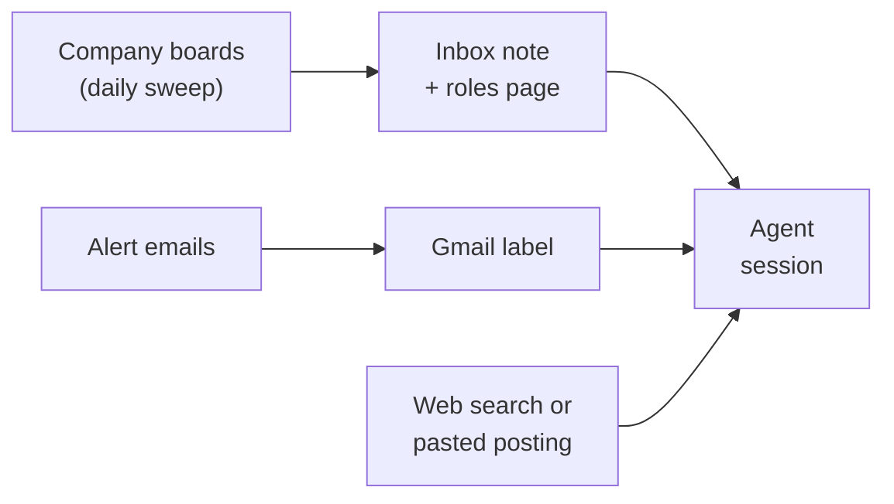
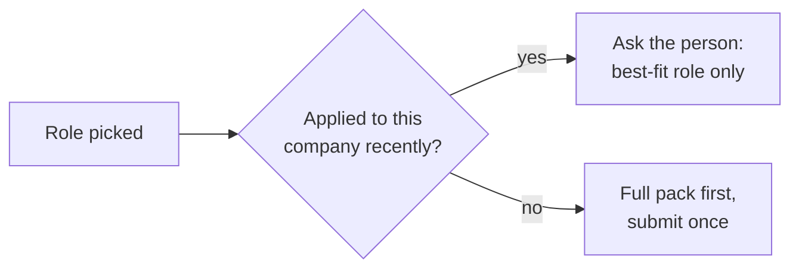

# Agent workflow

The code in this repo is deterministic and uses no LLM. The steps that need judgement, such as reading postings, scoring fit and preparing applications, are done by an LLM agent: Claude Code, in a session a person starts. This page is the playbook the agent follows. It is adapted from the working notes the agent reads at the start of each session.

Two rules apply throughout:

- **Nothing is submitted by the agent.** It prepares; a person reviews and presses submit.
- **Only public sources, read politely.** No logged-in automation of personal accounts.

## Who does what

| Step | Who | How |
|---|---|---|
| Daily sweep, dedupe, health checks, inbox note, roles page | Automated | Docker container running this repo |
| Job-alert emails | Automated | Board and agency alert emails, filtered into one Gmail label |
| Reading alerts | Agent | Gmail MCP connector, that label only |
| Searching the web for postings | Agent | Reactive Resume MCP: `api_applications_ai_search_postings` (Tavily, five links per search) |
| Scoring and dedupe | Agent | Rubric below; checked against applications already in Reactive Resume |
| Tailored resume and cover letter | Agent | Reactive Resume MCP: a tailored copy of a master resume |
| Filling the application form | Agent | Claude in Chrome, one tab per role, stopping before the submit button |
| Review and submit | **Person** | Checks each tab and submits |
| Stage updates and follow-ups | Agent | Reactive Resume MCP |

## A session

1. The person asks the agent to start the job search.
2. The agent reads today's inbox note (new roles and any sweep problems) and the alerts label (`search_threads`, `get_thread` on the Gmail connector).
3. For each candidate role it fetches the full posting: `jd.py` for Greenhouse and Ashby boards, or `api_applications_ai_parse_posting` for any public posting URL.
4. It scores each role against the rubric, shows the breakdown, and dedupes against `list_applications`.
5. It records scores in `data/scores.json`, so the roles page shows them (★) after its next rebuild.
6. It reports a shortlist. The person picks the roles to pursue.
7. For each picked role it prepares the application (next section), then hands the review list to the person.

## Sources

- **Allowed:** company careers pages and their public ATS boards; public web search; the public listing pages of contract and remote job boards; posting text the person pastes in (for example from LinkedIn).
- **Not allowed:** logged-in automation of LinkedIn or any other personal account. A LinkedIn MCP server that drives a logged-in browser session was evaluated and rejected, because LinkedIn's user agreement prohibits automated access and the account matters too much to risk. Also not allowed: anything robots.txt disallows (which is why the SmartRecruiters reader is off), and creating accounts.
- The canonical link is always the employer's own posting, not an aggregator's copy. Postings older than about 30 days, or gone from the employer's site, are skipped.

## Fit rubric (out of 10)

| Part | Points | Question |
|---|---|---|
| Skills | 0–4 | How much of the required stack and domain does the candidate cover? |
| Seniority | 0–2 | Does the level match the candidate's experience? |
| Type and location | 0–2 | How well do the employment type and location fit the candidate's constraints? |
| Edge | 0–2 | Does the role value specialist skills the candidate has and most applicants won't? |

- **7 or more:** shortlist. **5 to 6:** a one-line mention. **Under 5:** skipped, with the reason.
- Every scored role shows its breakdown, for example `7 = skills 3 + seniority 1.5 + type/location 1 + edge 1.5`, with the three strongest matches and the gaps or red flags, so the person can challenge it.
- The person sets a separate bar for what the agent prepares without being asked, and reviews it after a few days against how many applications are ready. Firms with an apply-once or cooldown rule keep a higher bar, so the one chance isn't spent on a weak fit.
- The score only decides what the agent prepares unprompted. The person can apply to anything, and any role they ask about gets prepared regardless of score.
- **Dropped automatically:** defence or military work, junior roles, roles needing security clearance, and residency or work-authorisation requirements the candidate can't meet. Full-time US-payroll remote roles almost always require US work authorisation even when the posting doesn't say so; US roles that hire international contractors stay in.
- **Agencies:** for contract roles an unnamed client is normal. Keep the role if the posting is specific and current, and note the agency.

## Preparing a picked role

All calls are tools on the self-hosted Reactive Resume MCP server unless marked otherwise.

| Step | Tool calls |
|---|---|
| 1. Dedupe on company and role | `list_applications` |
| 2. Read the posting into fields (role, company, location, requirements, posting text) | `api_applications_ai_parse_posting` |
| 3. Save the application at stage `saved`, with location, source, URL, job description, tags (track, contract or full-time, remote) and the master resume linked | `create_application` |
| 4. Make a tailored copy of the master resume, linked to the application | `api_documents_copy_for_job` |
| 5. Tailor it with targeted edits, then run the resume checks (contact, dates, layout, headings, writing) | `read_resume`, `apply_resume_patch` (JSON Patch), `api_rest_check_resume` |
| 6. Write the cover letter, linked to the application and resume. Body text only: the structured layout adds its own greeting and sign-off | `create_cover_letter`, `update_cover_letter` |
| 7. Export the files to upload | `download_resume_pdf`, `api_rest_document_exports_letter` |
| 8. Fill the employer's form in a new browser tab and stop before submit | Claude in Chrome (`tabs_create_mcp`, `navigate`, `find`, `browser_batch`) |
| 9. After the person submits: move to `applied` and set a follow-up date 7–10 days out. Reaching `applied` also freezes the linked resume as the version sent | `update_application` |
| Pipeline summary on request | `get_application_stats` |

Screening-question answers are drafted for the person to review. Salary questions are left to the person.

## The apply-once guard

Some employers let a candidate apply only once per role, or once per company within a period (often 6–12 months), and some cap how many roles one candidate can apply for at the same time. A rushed or half-finished application can lock the candidate out.

- One role per company at a time, unless the roles are clearly in different teams.
- Never submit a test, a draft or a half-complete form. Prepare everything first, then submit once.
- Record the submission in Reactive Resume straight away, so the guard has data next time.

## What the first runs showed

- Company ATS boards list almost only full-time roles. Engineering contracts come through agencies and job boards, and several of those block automated reading. They reach the agent through email alerts instead.
- Most remote "contract" platforms turned out to be AI-training gig work, so they are excluded.
- A macOS launch agent couldn't read files under `~/Documents` (privacy protection). Moving the sweep into a Docker container with bind mounts fixed that, and the scheduler catches up after the host has been asleep.
- Boards fail silently when a company moves to another ATS or renames its board. The health check in every note exists for that reason. At one point 30 boards were unreadable: 18 were fixed by finding the new ATS or board ID, and the other 12 had no public board and became "check by hand" entries.
